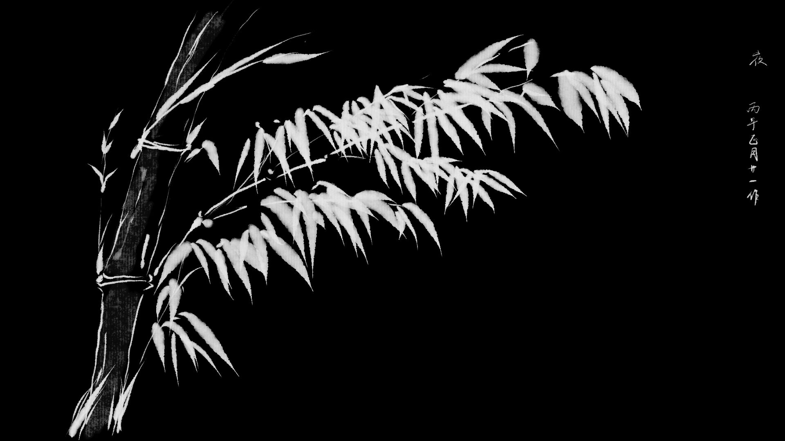
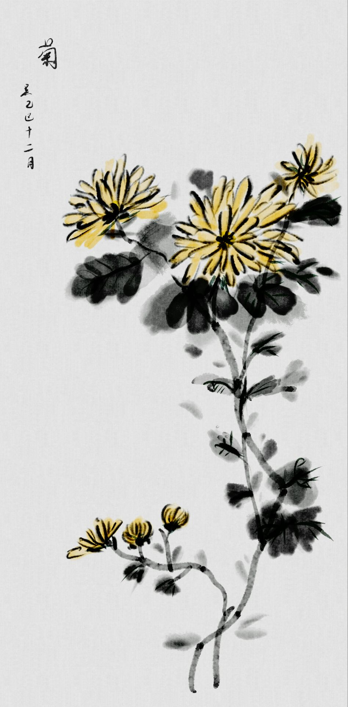
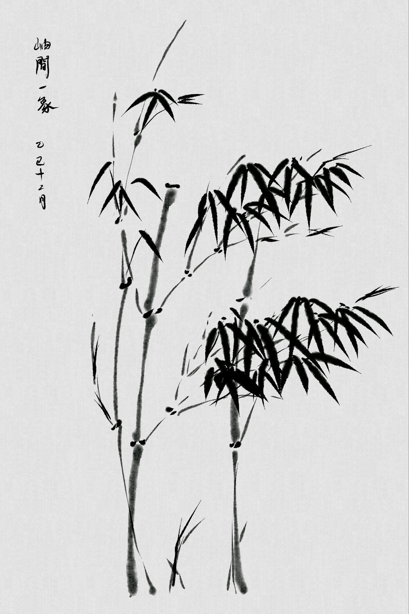
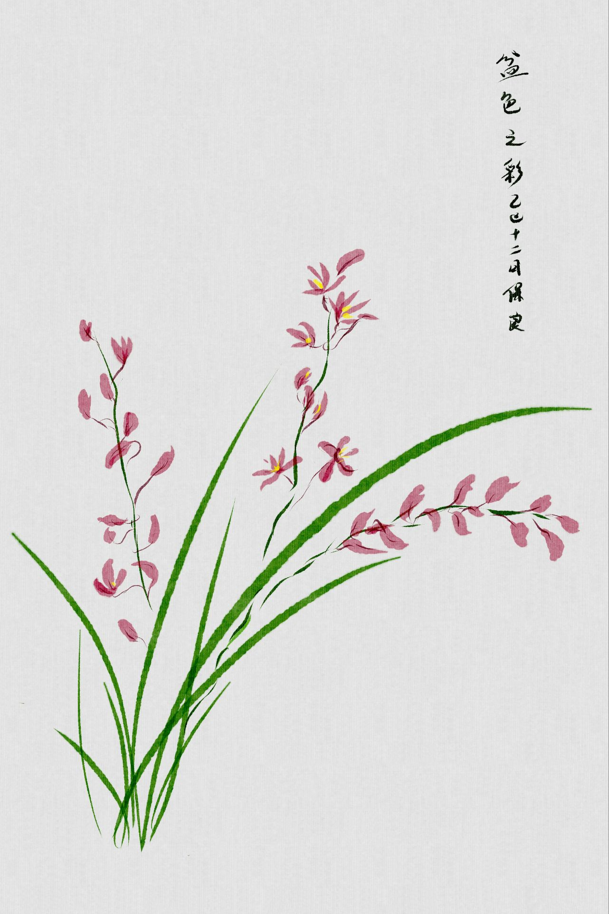
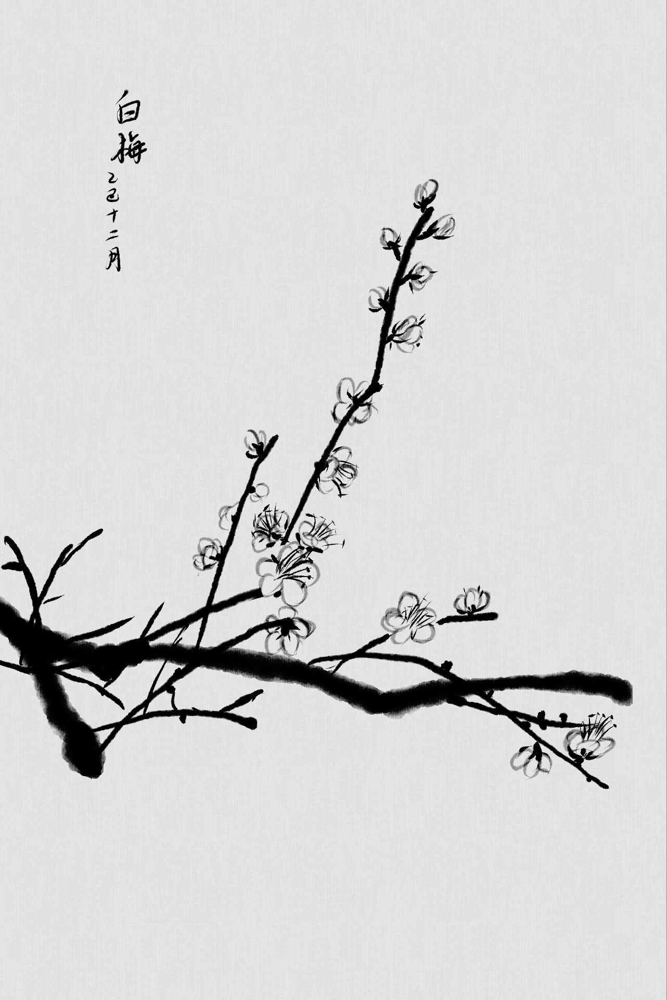

<!-- Personal file 个人文档
-->

  
  
自绘

  
  
来自：堆糖-20180413211549_kzdeV

<h1 align="center">- B . H . C -</h1>

保障一切顺利、万全准备的情况中 
不断求索，不断调优，自胜百胜

<h3 align="center">- 画 -</h3>

  
  
  
  
  
自绘

 
 
 
 
 

<h4 align="center">- 文 -</h4>

西江月 
长夜悲歌无惧，星潮月涌去将。 
武夷开外太清凉，天侧永无朝绛。  
黎醒溪河明暗，湿缠故土无苍。 
早樱素草遍山花，冬九难放春朗。 

