<!-- Personal file 个人文档
-->

  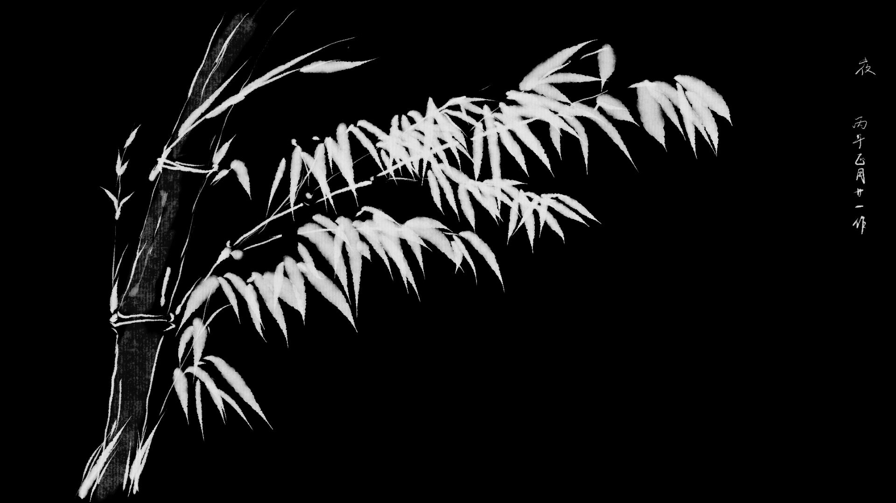
  
自绘

  
  
来自：堆糖-20180413211549_kzdeV

<h1 align="center">- B . H . C -</h1>

保障一切顺利、万全准备的情况中 
不断求索，不断调优，自胜百胜

<h3 align="center">- 画 -</h3>

  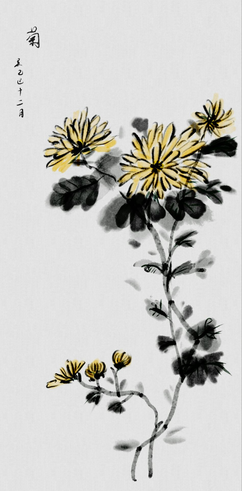
  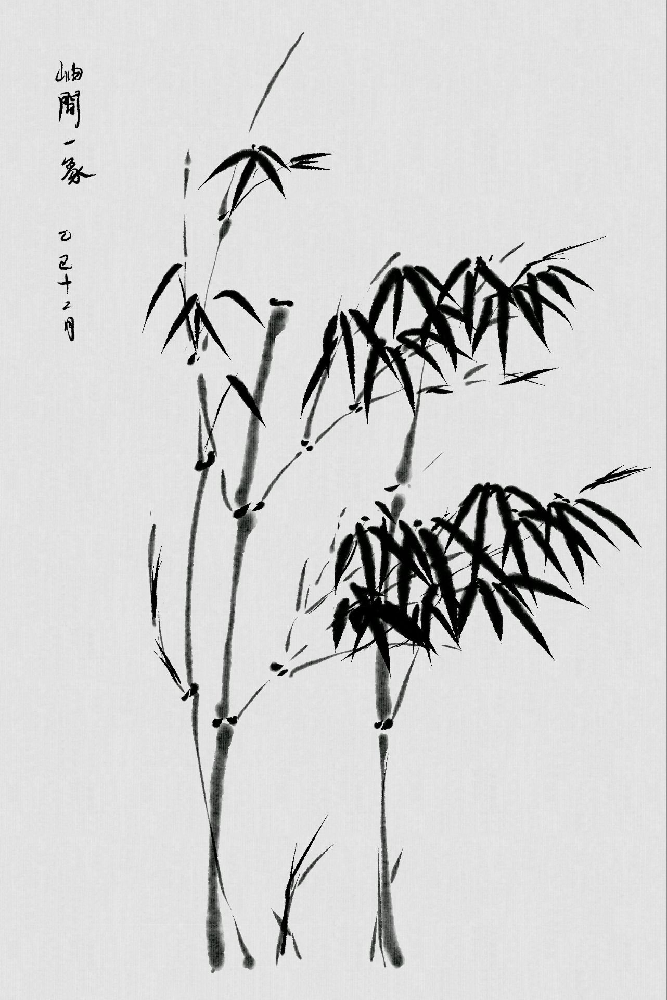
  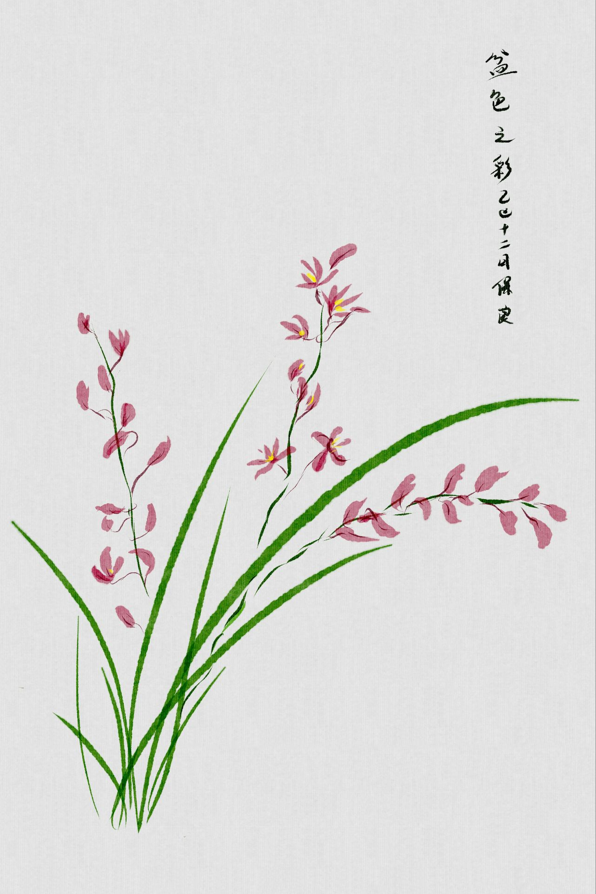
  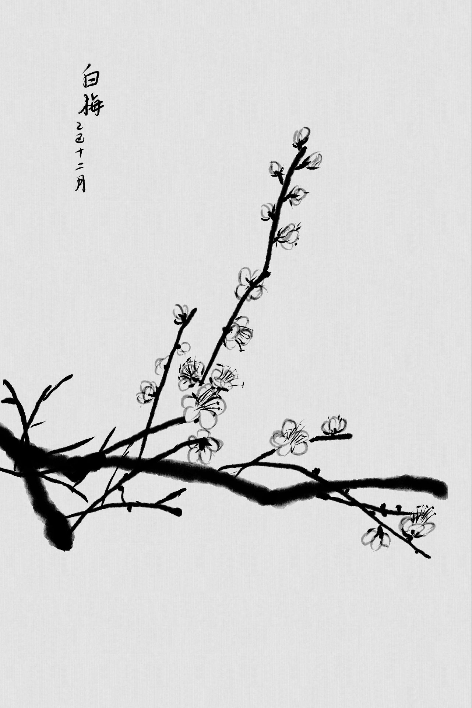
  
自绘

 
 
 
 
 

<h4 align="center">- 文 -</h4>

西江月 
长夜悲歌无惧，星潮月涌去将。 
武夷开外太清凉，天侧永无朝绛。  
黎醒溪河明暗，湿缠故土无苍。 
早樱素草遍山花，冬九难放春朗。 

<!-- HEATMAP:START -->
<h4 align="center">- 活动 -</h4>

  <picture>
    <source media="(prefers-color-scheme: dark)" srcset="./assets/heatmap-dark.svg">
    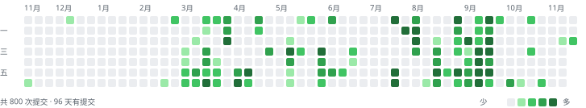
  </picture>

近一年 800 次提交 · 96 天有提交 · 只统计次数，不显示仓库名、议题与合并请求的标题

按年份看（点开）

  
<picture>
      <source media="(prefers-color-scheme: dark)" srcset="./assets/years/year-2026-dark.svg">
      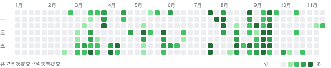
    </picture>

  
<picture>
      <source media="(prefers-color-scheme: dark)" srcset="./assets/years/year-2025-dark.svg">
      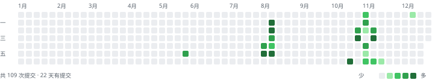
    </picture>

  
<picture>
      <source media="(prefers-color-scheme: dark)" srcset="./assets/years/year-2024-dark.svg">
      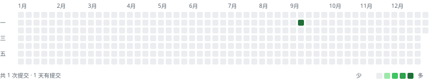
    </picture>

2026 年每月（鼠标悬停每张小图看次数）

    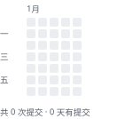 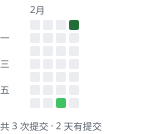 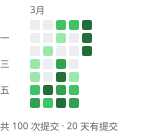 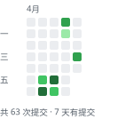 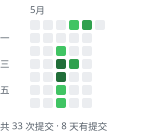 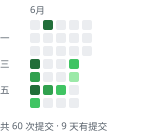 
    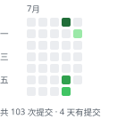 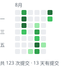 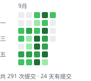 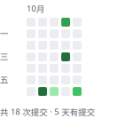 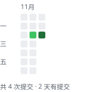

<!-- HEATMAP:END -->

<!-- ===== 临时：脚本能不能跑的实验，验证完整段删掉 ===== -->

脚本探针（临时测试块，验证完删除）

**A. 外部文件**（点了会变出绿色徽章 + 月度小图可点）

**B. 内联 script**

**C. img onerror**
C onerror 执行了</b>')">

**D. javascript: 链接**
<a href="javascript:document.body.insertAdjacentHTML('beforeend','<b style=color:#cf222e>D 执行了</b>')">点我试 D</a>

**E. iframe srcdoc**
<iframe srcdoc="&lt;script&gt;parent.document.body.insertAdjacentHTML('beforeend','&lt;b style=color:#cf222e&gt;E 执行了&lt;/b&gt;')&lt;/script&gt;" width="200" height="30"></iframe>

**F. 对照组：纯 style 属性**（这行应该是红框，说明 HTML 属性本身没被删）

F 红色边框 = HTML 属性保留

<!-- ===== 临时测试块结束 ===== -->

